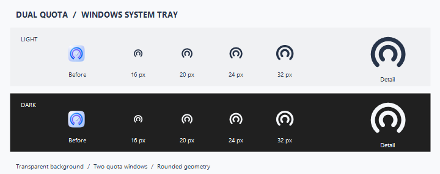

# ChatGPT 额度仪表盘（macOS / Windows）

这是一个独立的桌面小工具，用仪表盘图标和文字直接显示 Codex 账户的两个限额窗口：

- 5 小时窗口剩余比例
- 7 天窗口剩余比例
- 两个窗口的预计重置倒计时
- 实时读取时间与数据来源标识

## Windows

Windows 版本保留 macOS 版本的额度读取、快照回退、详情弹窗和刷新菜单；macOS 菜单栏项目对应替换为 Windows 系统托盘 `NotifyIcon`。左键托盘图标显示/关闭详情，右键菜单可显示额度、立即刷新或退出；托盘悬停提示显示 5 小时与 7 天剩余比例。

托盘图标使用 Windows 11 风格的透明底单色双环，表达 5 小时与 7 天两个额度周期；随任务栏深浅色和系统缩放自动重绘。双环作为固定的产品标识，具体额度见悬停提示和详情页。



当前可用的 Windows 安装包位于 `Windows/Packages/ChatGPT额度仪表盘.exe`。双击这个 `.exe` 后会按当前用户安装，不需要管理员权限，并创建桌面、开始菜单快捷方式和卸载项；安装器完成后立即退出，安装后的程序和快捷方式不通过 `cmd.exe` 启动。

## macOS

macOS 详情页与 Windows 统一信息结构：顶部按实际档位显示订阅标题（如“Plus 订阅”），右侧为刷新／关闭按钮，下方两张额度卡片依次显示 5 小时、7 天窗口；每张卡片包含大号剩余比例、重置倒计时、具体重置时间、消耗速率与细进度条，5 小时卡按小时显示（`x%/h`），7 天卡按天显示（`x%/天`）。底部显示更新时间及实时／快照／连接中／连接失败状态。正常额度数字、进度条、工具按钮和实时徽标使用语义主色（浅色外观为黑／深灰，深色外观为白／浅灰）；快照状态使用系统橙色，连接失败使用系统红色。5 小时剩余低于 20%、7 天剩余低于 10% 时，对应卡片改用系统橙色。

Mac 保留适配 macOS 27 的原生 Liquid Glass 弹层与玻璃工具按钮。卡片采用低不透明度的系统中性色玻璃着色，让 NSPopover 的原生玻璃底层透出：浅色模式不透明度为 0.16，深色模式为 0.10；增加对比度时分别提高至 0.26 和 0.20。启用减少透明度时使用不透明系统卡片与背景，macOS 13–25 则以标准 ultra-thin material 作为卡片和背景回退。Windows 沿用现有设计。支持系统深浅色、增加对比度、减少透明度和减少动态效果设置，⌘R 可刷新额度。

原有菜单栏项目和 Swift/AppKit 构建方式保持不变；可使用 `--show-details` 启动参数自动展开详情页。

Mac 应用图标采用接近 ChatGPT 图标的白底／石墨黑扁平配色，以两条额度条表达两个限额窗口；图标本身使用不透明实底，液态玻璃仅用于详情页。`Mac/Codings/render-icon.swift` 同源生成 SVG 和 PNG，运行 `build-icon.sh` 可重新制作全部标准图标尺寸。

## 启动

当前 macOS 安装包为 `Mac/Packages/ChatGPTQuotaPet-1.5-LiquidGlass.dmg`。打开磁盘映像后，将 `ChatGPTQuotaPet.app` 拖到 `Applications` 即可安装。1.5 修复新版 ChatGPT 内置 Codex 路径变化导致的额度停止更新，并在实时接口断开时选用较新的会话快照、显示连接错误。

双击 `Mac/Codings/Start-ChatGPTQuotaPet.command`。首次运行会编译并打开 `Mac/Packages/ChatGPTQuotaPet.app`；之后也可以直接双击 `Mac/Packages/ChatGPTQuotaPet.app`。

状态栏会直接显示两行剩余额度：上面是 `5h 76%`，下面是 `7d 76%`。左侧自定义额度图标借用 Codex 图标的柔和六瓣轮廓与终端 `>` 提示符线索，右侧两条量尺分别编码 5 小时与 7 天剩余比例；图标为系统标签色模板，随浅深外观以黑白呈现。这是额度产品的状态标识，不是官方 Codex 标志。点击状态栏项目后，会在状态栏下方展开额度详情；点击外部或按 Esc 可关闭弹窗，右键状态栏项目可立即刷新或退出。

如果系统阻止 `.command` 或 `.app`，请在“系统设置 → 隐私与安全性”中允许打开，或先在终端执行：

```zsh
chmod +x ./Mac/Codings/Start-ChatGPTQuotaPet.command ./Mac/Codings/build-mac.sh
```

## 编译与自检

```zsh
./Mac/Codings/build-mac.sh
./Mac/Packages/ChatGPTQuotaPet.app/Contents/MacOS/ChatGPTQuotaPet --probe
```

`build-mac.sh` 会按当前 Mac 的 CPU 架构编译，并以 macOS 13.0 为最低兼容版本。自检只输出剩余比例、采样时间和来源，不输出原始会话内容。

## 数据来源与限制

程序优先通过本机 Codex `app-server` 的 `account/rateLimits/read` 接口读取实时额度，不读取 `auth.json`，不保存访问令牌。若本地接口暂时不可用，会自动回退到 `~/.codex/sessions/` 中最近的 `rate_limits` 快照，并在弹窗底部标记为“快照”。

此版本显示的是 Codex/ChatGPT 账户中 Codex 相关的 5 小时与 7 天限额，不是 ChatGPT 普通对话、语音或图片额度的统一总余额；额度数据仍以官方使用情况页面为准：

<https://learn.chatgpt.com/docs/pricing>

如果仍显示“暂时没有可用快照”，请确认 Codex 已登录并在 ChatGPT/Codex 中运行一次任务，再重新启动工具。
